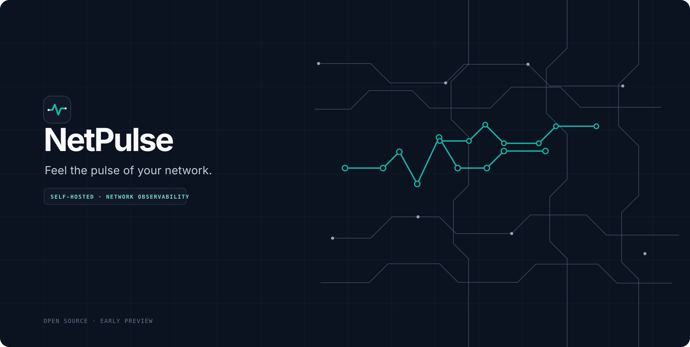

# NetPulse



[Project site](https://rizkiramadhani561.github.io/NetPulse/) · [Documentation overview](docs/site/docs.html) · [Brand guidelines](docs/BRAND_GUIDELINES.md)

**Feel the pulse of your network.**

NetPulse is an early-stage, self-hosted network-monitoring dashboard for home labs, small offices, schools, and IT support teams. The goal is to make useful network checks easier to set up and understand, without needing a large monitoring stack from day one.

> **Current status: Phase 0 foundation implemented; final integration deferred.** Backend/frontend CI, Storybook build, audits, and secret scanning pass. Docker Compose runtime, the isolated lab runtime, browser accessibility inspection, and independent review remain outstanding. Device monitoring, authentication, persistent storage, alerts, and discovery are still planned. Do not expose this preview to an untrusted network or rely on it for production monitoring.

## What's in the stack

- **API:** Python 3.14, FastAPI, and Uvicorn
- **Data:** SQLite (WAL), SQLAlchemy, and Alembic; PostgreSQL may be added as an optional profile later
- **Web:** Next.js App Router, TypeScript, React, and Tailwind CSS
- **Run locally:** Docker Compose, with a separate network lab overlay
- **Checks:** pytest, Ruff, TypeScript checks, Storybook, Gitleaks, and dependency audits

Feature scope, UX notes, architecture decisions, and the project log live under docs/spec and docs/ai. Feature requirements will be made testable in docs/ai/TRACEABILITY.md before implementation.

## Docker integration (deferred)

The Compose stack and isolated lab are defined, but runtime validation is intentionally deferred until the full feature set is ready. Do not rely on the current preview for real monitoring, and do not treat a successful source build as proof that the container stack works.

At the final integration stage, use PowerShell from the repository root:

```powershell
Copy-Item .env.example .env
docker compose up --build
```

Then check [http://localhost:3000](http://localhost:3000) and [http://localhost:8000/api/v1/health](http://localhost:8000/api/v1/health). Stop with Ctrl+C and run `docker compose down`. The default ports bind to `127.0.0.1`; the lab overlay is not enabled by default. Read [lab/README.md](lab/README.md) before enabling it. The final runtime check must pass before the project is treated as fully integrated.

## Verify locally

On Windows PowerShell:

```powershell
./scripts/verify.ps1 -Mode quick
./scripts/verify.ps1 -Mode full
```

From Git Bash or WSL:

```bash
bash ./scripts/verify.sh --quick
bash ./scripts/verify.sh --full
```

The quick check covers key files and safety contracts. Full verification additionally runs locked dependency installs, Ruff, mypy, backend tests with a 70% coverage floor, pip-audit, TypeScript, the Next.js and Storybook builds, npm audit, and Gitleaks. It writes a Markdown report and per-step logs under `docs/ai/verification/local-*`. Docker Compose runtime integration is deliberately held for the final stage; it has a manual GitHub Actions job and is not counted as passed by local `--full`.

## Roadmap

| Phase | Scope | Status |
|---|---|---|
| 0 | Project scaffold, safe defaults, API and web shells, lab foundation | Implementation checks green; final integration deferred |
| 1 | Setup, login, device management, monitoring state, dashboard, alerts | Planned |
| 2 | TCP/HTTP/DNS/SSL checks, SNMP, discovery, incident history | Planned |
| 3 | Topology, reporting, accessibility, and complete translations | Planned |
| 4 | Integrations, demo content, backup and restore | Planned |
| 5 | Hardening and v1.0.0 release preparation | Planned |

## Security

No telemetry is planned. Keep .env files, database files, backups, router credentials, SNMP credentials, and tokens out of Git. Read [SECURITY.md](SECURITY.md) before reporting a vulnerability. Network scanning is intended for networks you own or have permission to test, with private networks as the default scope.

## Language and contribution

The English README is here; the Indonesian version is [README.id.md](README.id.md). See [CONTRIBUTING.md](CONTRIBUTING.md) before opening a larger change.

## License

MIT. See [LICENSE](LICENSE).
